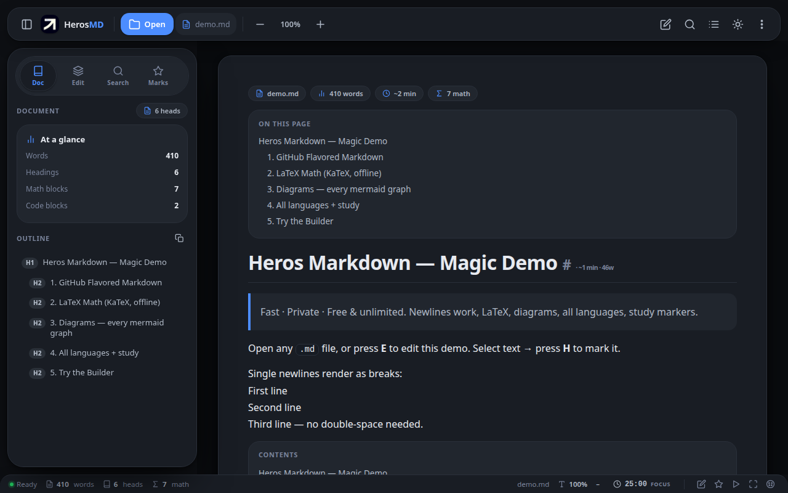
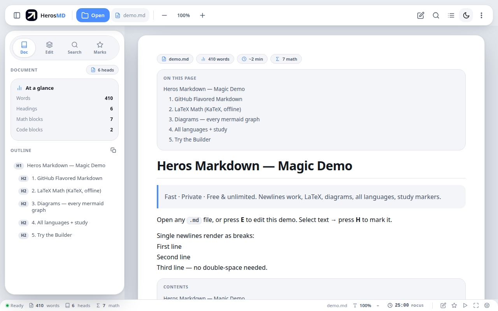
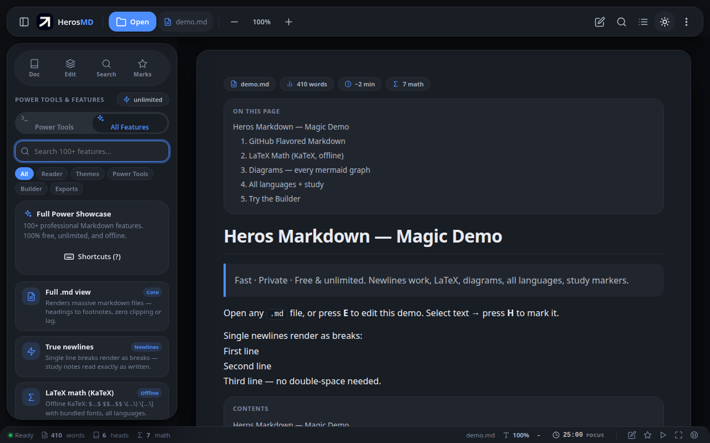
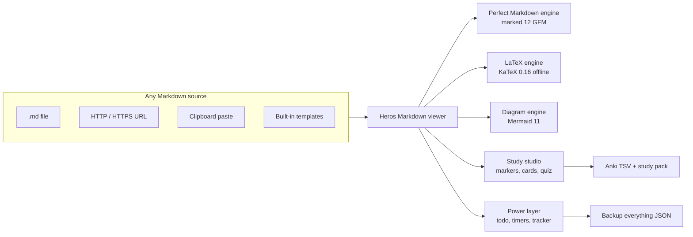
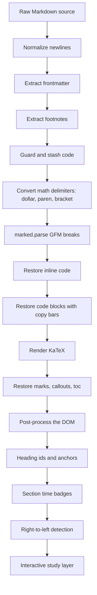
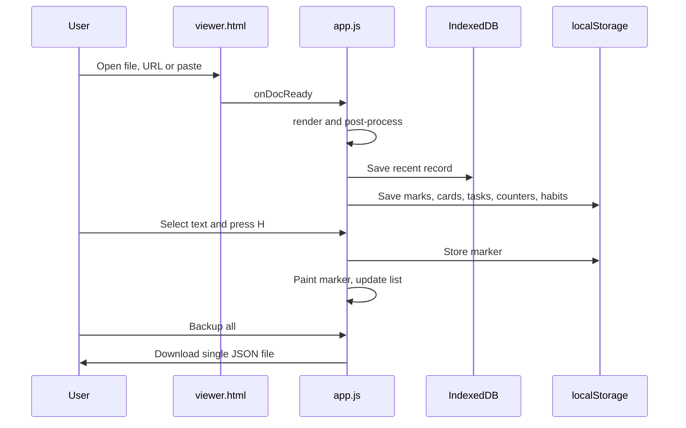
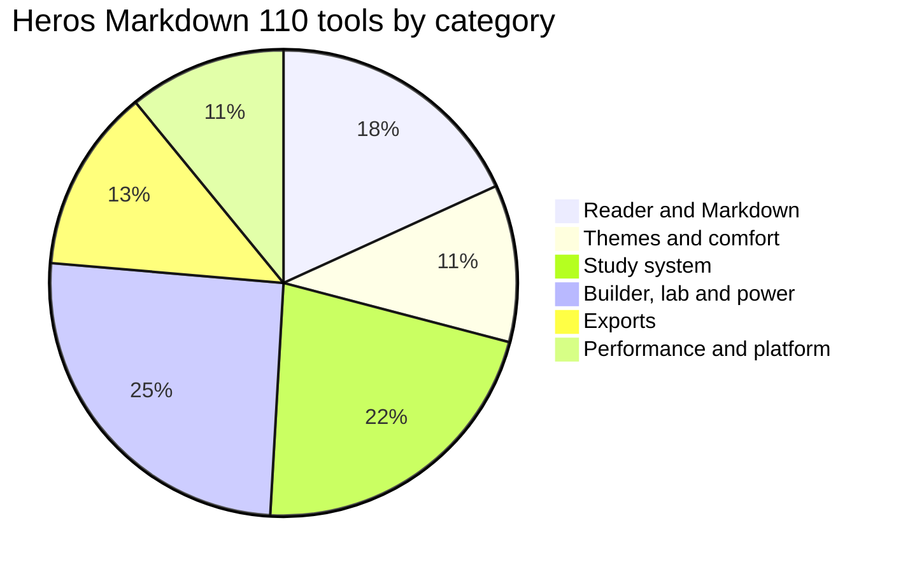
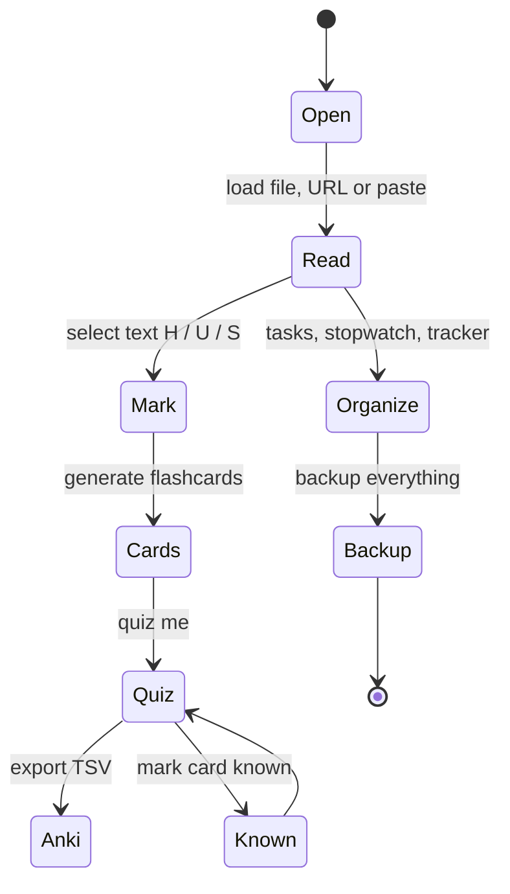
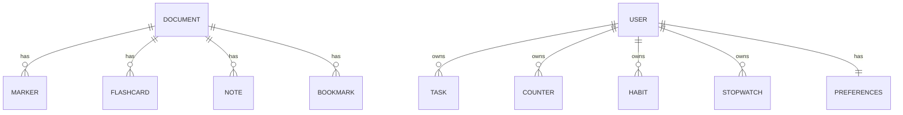

# Heros Markdown

<div align="center">


## Heros Markdown

**A fast, private, free and unlimited Markdown studio for Chrome, Edge and Brave — with the complete app experience on mobile via Kiwi Browser.**

 Extension icon `icons/icon128.png` &nbsp;·&nbsp;  `icon48` &nbsp;·&nbsp;  `icon32` &nbsp;·&nbsp;  `icon16`

> Built by [Ahmed ABOBAKR](https://www.linkedin.com/in/ahmed-abo-bakr-1b2466288/?isSelfProfile=true) · [github.com/Ahmedbakr78](https://github.com/Ahmedbakr78) · [Install](#install) · [All 110 features](#all-110-features) · [Architecture](#architecture) · [Releases](RELEASE_v1.2.0.md) · [Changelog](CHANGELOG.md)

      

</div>

---

## Table of contents

1. [What is Heros Markdown](#what-is-heros-markdown)
2. [Feature highlights](#feature-highlights)
3. [All 110 features](#all-110-features)
4. [Markdown support matrix](#markdown-support-matrix)
5. [Architecture](#architecture)
6. [Install](#install)
7. [Using the app](#using-the-app)
8. [Keyboard shortcuts](#keyboard-shortcuts)
9. [Study system in depth](#study-system-in-depth)
10. [Privacy and offline](#privacy-and-offline)
11. [Mobile](#mobile)
 15. [Backup, restore and data](#backup-restore--and-data)
 16. [Feature map and release history](#feature-map-at-a-glance)
 17. [Development](#development)
 18. [Roadmap](#roadmap)
 19. [FAQ](#faq)
 20. [Usage examples](#usage-examples)
 21. [Author](#author)
 22. [License](#license)

---

## Heros Markdown icon

The extension and repository icon lives in `icons/` and is used on every page:

| File | Size | Used for |
|---|---|---|
| `icons/logo.png` | 512 × 512 | Master app icon, social preview, README header |
| `icons/icon128.png` | 128 × 128 | Chrome Web Store and browser chrome |
| `icons/icon48.png` | 48 × 48 | Extension management page |
| `icons/icon32.png` | 32 × 32 | Toolbar retina and Windows taskbar |
| `icons/icon16.png` | 16 × 16 | Toolbar, favicon, context menus |
| `icons/apple-touch-icon.png` | 180 × 180 | iOS home screen |

Copies for the website and distribution are in `assets/app-icon-512.png`, `assets/app-icon-192.png`, `assets/app-icon-128.png` and `assets/app-icon-maskable-192.png`.

---

## Screenshots

| Dark reader | Light reader | Features list |
|---|---|---|
|  |  |  |

---

## What is Heros Markdown

Heros Markdown is a browser extension that turns your browser into a **complete Markdown reading and studying environment**. It renders every part of the Markdown specification plus extended syntax, offline LaTeX mathematics, every Mermaid diagram type, every written language including right-to-left scripts — and it adds a full study studio: text marking, flashcards, quizzes, tasks, timers, counters and habit tracking.

It was built around four principles:

| Principle | What it means |
|---|---|
| Perfect | Newlines, tables, tasks, footnotes, callouts, math and diagrams render exactly as written, in every supported language |
| Fast | Pure vanilla JavaScript, debounced rendering, idle diagram parsing, perf mode for very large files |
| Private | No accounts, no telemetry, no cloud. Files, marks and tasks stay on the device |
| Free | All 110 tools unlocked, unlimited documents, no subscriptions, MIT licensed |



---

## Feature highlights

- **Perfect rendering.** Single newlines render as line breaks (toggleable), GitHub Flavored Markdown tables with tap-to-sort, interactive task lists that write back to the source, footnotes, YAML frontmatter, GitHub-style callouts (`> [!NOTE]`), collapsible `<details>` blocks, `[[toc]]` auto contents, `==highlight==` and `++underline++` syntax.
- **Offline LaTeX.** Inline `$…$`, display `$$…$$` and the standard `\(…\)` and `\[…\]` forms, rendered by a bundled KaTeX with bundled fonts. Currency amounts such as `$1.00` are never mistaken for math.
- **Every diagram language.** Mermaid flowcharts, sequence diagrams, mindmaps, Gantt charts, pie charts, user journeys, git graphs, class and state diagrams, timelines and ER diagrams — rendered in a queue, themed with the app, exportable as SVG, with syntax errors shown as clean source panels instead of blank boxes.
- **Every language.** Arabic, Hebrew, Persian and Urdu blocks flip to right-to-left automatically. Chinese, Japanese and Korean characters are counted correctly. Search is Unicode-aware, so whole-word matching works outside Latin scripts.
- **Marker Studio copied from Heros PDF.** Select any text and a floating mini-bar appears: highlight, underline, strikethrough, copy, note. Keyboard shortcuts `H`, `U`, `S`, `C` work directly on the selection. Marks are stored per document with seven colors and can be exported.
- **Learn and remember.** Flashcards are generated automatically from headings, `Q:` / `A:` pairs, bold terms and `==cloze==` blanks. The quiz mode reveals answers, tracks a score and writes Anki-compatible TSV files that can also be imported back.
- **Stay organized.** A task manager with priorities and due dates, a stopwatch with saved laps, named tally counters and a habit tracker with a 14-day grid and streak counting — all saved automatically and included in a single backup file.

---

## All 110 features

### Reader and perfect Markdown (20)

| # | Feature | Description |
|---|---|---|
| 1 | Full .md view | Renders massive files from headings to footnotes with zero clipping |
| 2 | True newlines | Single line breaks render as breaks for natural study notes |
| 3 | LaTeX math (KaTeX) | Offline engine with `$…$`, `$$…$$`, `\(…\)`, `\[…\]` |
| 4 | Every mermaid graph | Flow, sequence, mindmap, Gantt, pie, journey, gitgraph and more |
| 5 | All languages + RTL | Arabic, Hebrew, Persian and Urdu auto right-to-left layout |
| 6 | Callouts and details | `[!NOTE]`, `[!TIP]`, `[!WARNING]`, `<details>` accordions |
| 7 | `[[toc]]` auto contents | Insert `[[toc]]` and a navigable table of contents is generated |
| 8 | `==mark==` and `++ins++` | Highlight and underline syntax rendered directly |
| 9 | GFM tables | Alignment, wrapped scrolling, zebra rows, tap header to sort |
| 10 | Interactive task lists | Clickable checkboxes that sync state back to the source |
| 11 | Footnotes | `[^1]` references with bidirectional jump links |
| 12 | YAML frontmatter | Parsed into metadata chips and the document title |
| 13 | Outline map | Sidebar outline with active section tracking while scrolling |
| 14 | Section reading time | Every heading shows estimated minutes and word count |
| 15 | Full-text search | Instant results with case and whole-word options, exportable |
| 16 | CJK word counting | Chinese, Japanese and Korean characters counted correctly |
| 17 | Unicode search | Whole-word matching works in every written language |
| 18 | Auto-resume reading | Documents reopen at the saved scroll position |
| 19 | Recent files | IndexedDB history of the last 25 documents |
| 20 | Reading position bookmarks | Save and jump back to exact scroll positions per file |

### Themes and reading comfort (12)

| # | Feature | Description |
|---|---|---|
| 21 | Studio white theme | Crisp light theme with sharp borders |
| 22 | Dark theme | Deep dark surfaces with accent glow |
| 23 | System theme | Follows the operating system automatically |
| 24 | Accent palettes | Six built-in accent colors plus a full color picker |
| 25 | Page comfort modes | Sepia, night and dim reading modes |
| 26 | Four reading widths | Narrow, comfort, wide and full viewport |
| 27 | Typography scaling | Font size, line height, sans, serif and mono |
| 28 | Text justification | Even left and right edges |
| 29 | Sentence focus | Dims everything except the paragraph under the cursor |
| 30 | Focus mode | Hides the sidebar for distraction-free reading |
| 31 | Fullscreen | One tap distraction-free window |
| 32 | Presentation mode | Full-screen slide view for meetings and classes |

### Study system (24)

| # | Feature | Description |
|---|---|---|
| 33 | Marker Studio | Highlight, underline and strike with seven colors |
| 34 | Selection mini-bar | Floating toolbar near any text selection |
| 35 | Marker shortcuts | `H`, `U`, `S`, `C` apply directly to the selection |
| 36 | Per-file marker list | Panel with jump, delete and export |
| 37 | Marker export | All marks as a numbered text list |
| 38 | Flashcards auto-deck | Built from headings, `Q:`/`A:`, bold terms and cloze |
| 39 | Quiz mode | Reveal, navigate, score and known-state tracking |
| 40 | Anki TSV export | One-tap import file for spaced repetition |
| 41 | Anki TSV import | Paste `Question <TAB> Answer` lines to add cards |
| 42 | Study pack export | Outline, marks, notes, cards and tasks in one file |
| 43 | Per-document notes | Persistent notes attached to each document |
| 44 | Note from selection | Turn selected text plus a comment into a note |
| 45 | Pomodoro timer | Work and break cycles docked in the bottom bar |
| 46 | Timer chime | Offline audio signal on phase change |
| 47 | Stopwatch | Count-up timer with 50 saved laps |
| 48 | Tally counters | Named counters with custom step sizes |
| 49 | Habit tracker | 14-day check-in grid per habit |
| 50 | Streak counting | Consecutive-day streaks per habit |
| 51 | Study streak | Daily app-open streak counter |
| 52 | Todo manager | Tasks with priority, due date and filters |
| 53 | Checklist import | Paste any `- [ ]` list to create tasks |
| 54 | Todo export | Tasks as a Markdown checklist file |
| 55 | Writing goals | Session and daily word targets with progress bars |
| 56 | Word count goal check | Instant progress check command |

### Builder, lab and power tools (28)

| # | Feature | Description |
|---|---|---|
| 57 | Builder studio | Live Markdown editing with instant preview |
| 58 | Quick insert bar | Bold, headings, links, images, tables, math, mermaid |
| 59 | Image paste | Clipboard images embedded as compressed data URLs |
| 60 | Template gallery | Study, meeting, exam, journal, thesis and habit templates |
| 61 | Drag and drop | Drop any Markdown file anywhere to open |
| 62 | Load from URL | Fetch raw Markdown from any address |
| 63 | Markdown lint | Long lines, empty links, heading jumps, broken anchors |
| 64 | Extractive summary | Top sentences by word frequency, one tap |
| 65 | Keyword extractor | Most significant terms with counts |
| 66 | Word frequency | Ranked word list with bar charts |
| 67 | Readability score | Flesch reading ease and grade level |
| 68 | Copy as HTML | Rendered HTML to the clipboard |
| 69 | Copy outline | The heading outline as plain text |
| 70 | Copy heading links | Markdown link list for every section |
| 71 | Copy document stats | File, words, headings, math and reading time |
| 72 | Print selection | Print only the selected text with clean styling |
| 73 | Visual diff | Side-by-side document comparison using longest common subsequence |
| 74 | Diff patch export | Export changes as a unified patch file |
| 75 | Link checker | Validates internal anchors and external links |
| 76 | Spell scan | On-demand scan with an ignore list |
| 77 | Vim navigation | `hjkl`, half-page scroll, `gg`, `G`, `/` search |
| 78 | Custom CSS editor | Live style overrides saved per device |
| 79 | Command shortcuts | All features reachable from the menu and `F` list |
| 80 | Backup everything | One JSON file with all marks, cards, tasks and prefs |
| 81 | Restore everything | One-file restore of the complete state |
| 82 | Local file tip | Guidance when local access needs enabling |
| 83 | Auto-open control | Toggle taking over local and web `.md` links |
| 84 | Perf mode | Instant text for very large files, re-render on demand |

### Exports (14)

| # | Feature | Description |
|---|---|---|
| 85 | Markdown export | Source file download, including builder edits |
| 86 | Standalone HTML | Styled self-contained page with KaTeX link |
| 87 | Plain text export | Formatting stripped |
| 88 | Vector PDF | Print to PDF with a print-ready stylesheet |
| 89 | Word document | Word and LibreOffice compatible export |
| 90 | Obsidian format | Markdown with vault frontmatter |
| 91 | Notion format | HTML ready for import |
| 92 | GitHub GFM | Canonical GitHub-flavored file |
| 93 | Diagram SVG | Save a rendered diagram as vector |
| 94 | JSON model | Headings, counts and marks as structured data |
| 95 | CSV frequency | Word frequency table for spreadsheets |
| 96 | Anki TSV | Flashcard deck file |
| 97 | Study pack | One file with everything studied |
| 98 | Backup JSON | Complete application state |

### Performance and platform (12)

| # | Feature | Description |
|---|---|---|
| 99 | Idle diagram rendering | Mermaid parsed in idle time, never blocking paint |
| 100 | Render meter | Last render time shown in milliseconds |
| 101 | Debounced engine | Typing and scrolling never trigger redundant work |
| 102 | Resumable tasks | Long jobs can be cancelled |
| 103 | Zero-dependency UI | No framework, no build step, no tracking |
| 104 | Fully offline | No network use after install except opened URLs |
| 105 | Responsive layout | Phone, tablet and desktop drawer interface |
| 106 | Mobile ready | Identical feature set on Kiwi Browser |
| 107 | Silent boot | Instant paint with no startup animation |
| 108 | Safe rendering | Scripts and event handlers stripped from documents |
| 109 | Storage safety | Size and count caps with graceful overflow |
| 110 | Free forever | MIT licensed, no accounts, no paywalls |

---

## Markdown support matrix

| Category | Syntax | Supported |
|---|---|---|
| Block | Headings, paragraphs, blockquotes, thematic breaks | Yes |
| Block | Nested lists, ordered, unordered, mixed depth | Yes |
| Block | Callouts `[!NOTE]`, `[!TIP]`, `[!WARNING]`, `[!CAUTION]`, `[!IMPORTANT]` | Yes |
| Block | Collapsible `<details>` and `<summary>` | Yes |
| Block | `[[toc]]` automatic contents | Yes |
| Block | YAML frontmatter | Yes |
| Span | Bold, italic, strikethrough, inline code, images | Yes |
| Span | Links, autolinks, reference style links | Yes |
| Span | `==highlight==`, `++underline++`, `^super^` | Yes |
| Span | Footnotes `[^1]` with back references | Yes |
| Table | Pipe tables with alignment | Yes |
| Table | Tap header sorting, wrapped scrolling | Yes |
| Task | `- [ ]` and `- [x]` interactive lists | Yes |
| Math | Inline `$…$`, display `$$…$$` | Yes |
| Math | Standard `\(…\)` and `\[…\]` | Yes |
| Math | Environments, matrices, aligned blocks | Yes |
| Math | Currency-safe, no false positives on `$1.00` | Yes |
| Diagram | Flowchart, sequence, mindmap, Gantt, pie, journey | Yes |
| Diagram | Git graph, class, state, timeline, ER diagram | Yes |
| Diagram | Theme-aware rendering and SVG export | Yes |
| Diagram | Syntax error panel with preserved source | Yes |
| Code | Fenced blocks with language label and line count | Yes |
| Code | One-tap copy button per block | Yes |
| Code | Unclosed and tilde fences handled | Yes |
| Language | Right-to-left Arabic, Hebrew, Persian, Urdu | Yes |
| Language | Chinese, Japanese, Korean, Thai word counting | Yes |
| Language | Unicode search and whole-word matching | Yes |

---

## Architecture

```
Heros_Markdown
├── manifest.json          extension manifest, version 1.2.0
├── viewer.html            the application shell and all styles
├── app.js                 rendering, study system, power tools
├── background.js          link takeover and extension message bus
├── popup.html / popup.js  toolbar popup with auto-open toggles
├── docs/
│   └── index.html         public landing page
├── assets/
│   ├── app-icon-*.png     application icons at 4 sizes plus maskable
│   └── screenshots/       real application screenshots
├── vendor/
│   ├── marked.min.js      marked 12 GFM parser, bundled
│   ├── katex.min.js       KaTeX 0.16 renderer, bundled
│   ├── katex.min.css      KaTeX stylesheet
│   ├── mermaid.min.js     Mermaid 11 diagram engine, bundled
│   └── fonts/             KaTeX woff2 fonts, bundled
├── icons/                 extension icons and logo
├── README.md              this document
├── CHANGELOG.md           version history
├── RELEASE_v1.2.0.md      release notes for the latest version
├── REPO_META.md           GitHub About, topics, website and release setup
└── LICENSE                MIT license
```

### Rendering pipeline



### Data flow



---

## Install

Heros Markdown is a packed extension folder. There is nothing to compile. The same folder loads in every Chromium-based browser. The steps below are written for **Chrome**, **Vivaldi** and **Yandex Browser** first, then the other supported browsers.

### What is provided in this repository

| Item | Purpose |
|---|---|
| `manifest.json` | Extension definition, version 1.2.0, no build step |
| `viewer.html`, `app.js` | The complete application, one page, no dependencies |
| `background.js` | Takes over Markdown links automatically |
| `popup.html`, `popup.js` | Toolbar popup for the auto-open toggles |
| `vendor/` | marked, KaTeX with fonts, Mermaid, all bundled for offline use |
| `icons/` | App and extension icons, see the icon table above |
| `docs/index.html` | The public landing page for GitHub Pages |
| `assets/` | Icons for the store and website, plus real screenshots |
| `README.md` | This document |
| `CHANGELOG.md`, `RELEASE_v1.2.0.md` | Version history and release notes |
| `CONTRIBUTING.md`, `docs/ARCHITECTURE.md` | Contribution rules and technical design |

### Method A: Load unpacked from a folder (recommended, keeps updates local)

| Browser | Extensions page | Extra step before Load unpacked |
|---|---|---|
| **Google Chrome** | `chrome://extensions` | Enable **Developer mode** in the top-right |
| **Vivaldi** | `vivaldi://extensions` | Enable **Developer mode** in the top-right |
| **Yandex Browser** | `browser://extensions` | Enable **Developer mode** in the top-right |
| **Microsoft Edge** | `edge://extensions` | Enable **Developer mode** in the left sidebar |
| **Brave** | `brave://extensions` | Enable **Developer mode** in the top-right |
| **Opera** | `opera://extensions` | Enable **Developer mode** in the top-right |
| **Kiwi (Android)** | `chrome://extensions` | Enable Developer mode, then load the folder |

Steps for every browser:

1. Download this repository with **Code, Download ZIP** and unzip it. Keep the folder named `Heros_Markdown` with `manifest.json` directly inside it.
2. Open the extensions page for your browser from the table above.
3. Turn on **Developer mode**.
4. Choose **Load unpacked** and select the `Heros_Markdown` folder.
5. Pin the extension to the toolbar so the icon is always reachable.
6. For local files: open the extension details and enable **Allow access to file URLs**. Chrome, Vivaldi and Edge show this toggle on the extension card. Brave shows it on the details page. Yandex Browser keeps it on the details page as well.
7. Open any `.md` link, click the toolbar icon, or drag a Markdown file onto a browser window to start.

### Method B: Load the release ZIP without git users

1. Download `Heros_Markdown-1.2.0.zip` from the [latest release](https://github.com/Ahmedbakr78/heros-markdown/releases/latest).
2. Unzip it. You get a folder named `Heros_Markdown` that is already in load-ready shape.
3. Load unpacked exactly as in Method A.

### Method C: Command line for developers

```bash
git clone https://github.com/Ahmedbakr78/heros-markdown.git
cd heros-markdown
# Then: chrome://extensions -> Developer mode -> Load unpacked -> this folder
```

There is no `npm install`, no build, and no server. Everything runs from the folder.

### Browser specific notes

| Browser | What works | Notes |
|---|---|---|
| Chrome | Full, stable releases | The reference browser for this app |
| Vivaldi | Full | Also supports the Chromium extension panel; run the app as a tab for the best layout |
| Yandex Browser | Full | If a login wall blocks the store, load unpacked instead |
| Brave | Full | Turn off Shields on the extension page if loading is blocked |
| Edge | Full | `edge://extensions` uses the same Load unpacked flow |
| Opera | Full | Keep "Allow access to file URLs" enabled for local files |
| Safari | Not supported | Safari uses a different extension model; read exported study packs instead |
| Firefox | Not yet | A manifest version 2 variant is on the roadmap |

### Make it work with local files in three steps

1. Open the extension details page and enable **Allow access to file URLs**.
2. In the popup, keep **Auto-open local .md** switched on.
3. Open any local Markdown file from the file system and it opens in Heros Markdown automatically. If a file opens as plain text, use the Open button or drag-and-drop, which need no permission at all.

### Make it work with web Markdown files

GitHub raw links serve Markdown with the correct content type, so links like `https://raw.githubusercontent.com/user/repo/main/README.md` open directly with auto-open enabled. Other servers must allow cross-origin requests. If a server blocks it, copy the address from inside the app with Open from URL and use the same field with the fetch, or download the file and open it locally.

### Mobile: Kiwi Browser on Android

1. Install **Kiwi Browser** from the Play Store.
2. Open `chrome://extensions` inside Kiwi and enable Developer mode.
3. Choose **Load unpacked** and select the unzipped folder, or load a packed ZIP.
4. Open the toolbar menu and pick Heros Markdown.

The interface is responsive on phones: the sidebar becomes a drawer, toolbars collapse and the document reflows. Every feature, including markers, flashcard quizzes, tasks, timers and backup, works with touch.

### Operating system notes

| System | Notes |
|---|---|
| Windows | Use `%LOCALAPPDATA%` paths for backup files, no special setup |
| macOS | Chrome path is `~/Library/Application Support/Google/Chrome` |
| Linux | Use the user data directory if testing with a custom profile |
| Android | Kiwi Browser, see above |
| iOS | Safari cannot load extensions; export study packs instead |

### Verifying the install

Open the app, press **F** for the features list, and confirm three things: the list shows 110 cards, a rendered document shows heading time badges and working math, and the bottom status bar shows the timer and progress. If any of those fail, reload the extension from the extensions page.

---

## Using the app

| Action | How |
|---|---|
| Open a file | Drag and drop anywhere, `Ctrl+O`, or the Open button |
| Open a URL | Menu, Open from URL, any raw Markdown address |
| Paste content | Menu, Paste and write, or the Paste option on the start screen |
| Load a demo | The demo button on the start screen |
| Edit | Press `E` to open the builder with live preview |
| Mark text | Select text, then `H`, `U`, `S`, `C` or use the floating bar |
| Study | Tools tab, Generate flashcards, then Quiz me |
| Organize | Press `O` for tasks, stopwatch and timers in the Tools tab |
| Find tools | Press `F` for the searchable list of all 110 tools |
| Save everything | Hub, Backup all, and restore the same file later |

---

## Keyboard shortcuts

| Keys | Action |
|---|---|
| `Ctrl` + `O` | Open a Markdown file |
| `Ctrl` + `S` | Save the source as `.md` |
| `Ctrl` + `P` | Print or export a PDF |
| `Ctrl` + `F` | Search in document |
| `Ctrl` + `B` | Toggle the sidebar |
| `E` | Toggle the builder |
| `O` | Open the task manager |
| `F` | Open the features list |
| `H` `U` `S` `C` | Highlight, underline, strike, copy selection |
| `D` | Save reading position |
| `N` | Cycle page comfort mode |
| `T` | Toggle theme |
| `P` | Presentation mode |
| `+` and `-` | Increase or decrease text size |
| `F11` | Fullscreen |
| `1` to `6` | Load a template |
| `?` | Shortcut help |

---

## Study system in depth

### Marking

Selecting text inside a document shows a floating mini-bar with five actions: highlight, underline, strikethrough, copy and note. The same actions are available as single-letter shortcuts. Marks are grouped by document in the Marker Studio panel, where each entry can be clicked to jump to the text or removed with one button. Marks survive reloads and are included in backups and exports.

### Memorising

Flashcards are generated automatically from four sources: section headings with their first sentences, explicit `Q:` and `A:` pairs, bold terms with their sentence, and `==cloze==` blanks. The quiz view shows the question, reveals the answer with the space bar, moves with the arrow keys and records which cards are known. Decks export to Anki as tab-separated text and the same format can be imported to extend a deck.

### Organizing

The task manager supports priorities, due dates and filters for open, done and all tasks. Checklists written in Markdown can be imported in one action and exported back as a checklist file. The stopwatch records laps with per-interval times, the counters accept any step size and the habit tracker renders a 14-day grid with a streak counter per habit.

---

## Privacy and offline

- No accounts, no sign-in, no emails.
- No analytics, no telemetry, no crash reporting.
- No network requests except URLs that you intentionally open.
- Storage is limited to this device: IndexedDB for recent documents, localStorage for marks, cards, tasks, counters, habits and preferences.
- Rendered documents are sanitized: scripts, iframes and inline event handlers are removed before display.
- Uninstalling removes all data. Use Backup all first.

---

## Backup, restore and data

The **Backup all** action in the Hub writes one JSON file containing preferences, statistics, bookmarks, notes, markers, annotations, flashcards, tasks, counters, habits, stopwatch laps and the spell-check ignore list. **Restore** reads that file and rebuilds the whole state. The Hub shows the time of the last save.

Storage limits are handled gracefully: recent documents are capped at 25, markers at 400 per document, flashcards at 80 per document, laps at 50, habits at 40, counters at 60 and tasks at 500. All overflow is trimmed from the oldest entries with no error shown to the user.

---

## Development

```bash
# Clone
git clone https://github.com/Ahmedbakr78/heros-markdown.git
cd heros-markdown

# Load into a Chromium browser
# chrome://extensions -> Developer mode -> Load unpacked -> this folder

# Check syntax
node --check app.js
node --check background.js
node --check popup.js
```

There is no build step and no package manager. Everything ships as plain HTML, CSS and JavaScript with bundled vendor libraries. Pull requests are welcome for corrections, translations of templates and accessibility improvements.

---

## Roadmap

| Milestone | Status |
|---|---|
| Core reader, LaTeX, diagrams, search | Shipped in 1.0 |
| Marker Studio, flashcards, quiz, Anki | Shipped in 1.1 |
| Tasks, stopwatch, counters, tracker, full backup | Shipped in 1.2 |
| Plugin API for custom templates | Planned |
| Optional local sync between devices | Planned |
| Firefox build | Planned |

---

## FAQ

**A local Markdown file will not open.** Enable *Allow access to file URLs* on the extension details page, or use Choose file and drag-and-drop which need no extra permission.

**A very large file feels slow.** Perf mode paints the text immediately and skips heavy math and diagram rendering. Toggle math and diagrams back on in the Tools tab to render everything.

**Marks and tasks disappeared.** Check the Hub: marks are per document, identified by file name, size and content. Restoring a backup file brings everything back.

**Does it work on a phone.** On Android, install Kiwi Browser and load the unpacked folder. The full application runs there. On iOS, export study packs and read them in any Markdown app.

**Can I use my own styling.** The Tools tab has a custom CSS editor that applies styles instantly and stores them locally.

**Is it really free.** Yes. MIT license, all 110 tools, unlimited documents, no accounts.

---

## Feature map at a glance



## Study loop



## Release history

| Version | Date | Focus | Highlights |
|---|---|---|---|
| v1.0.0 | — | First release | Full reader, offline KaTeX, Mermaid, outline, search, builder, exports, themes |
| v1.1.0 | — | 100 tools | Marker Studio, flashcards, cloze quiz, Anki, templates, study lab, custom CSS, Vim keys |
| v1.2.0 | current | 110 tools | Task manager, stopwatch, counters, habit tracker, full backup, Heros PDF studio design, mobile drawer |

Full detail in [CHANGELOG.md](CHANGELOG.md). Release notes for the current version are in [RELEASE_v1.2.0.md](RELEASE_v1.2.0.md) and the download is on the [releases page](https://github.com/Ahmedbakr78/heros-markdown/releases/latest).

## Roadmap

```mermaid
gantt
    title Heros Markdown roadmap
    dateFormat YYYY-MM-DD
    axisFormat %Y
    section Core
    Reader, math, diagrams, search      :done, core, 2024-01-01, 2024-06-01
    Marker Studio and flashcards       :done, study, 2024-06-01, 2024-09-01
    section Study studio
    Tasks, timers, tracker, backup     :done, power, 2025-01-01, 2025-03-01
    Plugin API for templates           :active, plugins, 2025-03-01, 2025-06-01
    section Platforms
    Local sync between devices         :planned, sync, 2025-06-01, 2025-09-01
    Firefox build                      :planned, ff, 2025-09-01, 2025-12-01
```

## Storage model



## What is provided in this repository

| Path | Purpose |
|---|---|
| `manifest.json` | Extension definition, version 1.2.0 |
| `viewer.html`, `app.js` | The complete application in one page |
| `background.js` | Automatic takeover of Markdown links |
| `popup.html`, `popup.js` | Toolbar popup for auto-open toggles |
| `vendor/` | marked, KaTeX with fonts, Mermaid, bundled |
| `icons/` | App and extension icons |
| `assets/`, `assets/screenshots/` | Icons for store and website plus real screenshots |
| `docs/index.html` | The public landing page for GitHub Pages |
| `docs/ARCHITECTURE.md` | Technical design, storage and security notes |
| `README.md` | This document |
| `CHANGELOG.md` | Version history in Keep a Changelog format |
| `RELEASE_v1.2.0.md` | Release notes for the current version |
| `CONTRIBUTING.md` | Contribution ground rules |
| `REPO_META.md` | GitHub About, topics, website and release setup values |
| `LICENSE` | MIT license |

## Usage examples

| Goal | Steps |
|---|---|
| Study a chapter | Open the file, read, mark key lines with `H`, generate flashcards, quiz me |
| Revise with Anki | Tools, flashcards, Export Anki TSV, import the file in Anki |
| Prepare an exam | Load the Exam template, edit in the builder, press Apply, then quiz |
| Track a habit | Tools, Study tracker, add a habit, tap today, keep the streak |
| Time a session | Tools, Stopwatch, Start, Lap, Reset, laps are saved |
| Keep notes tidy | Marker Studio, write a note from the selection, export markers |
| Move to a new PC | Hub, Backup all, copy the JSON, Restore on the new machine |
| Share without sharing | Tools, Study pack export, send one Markdown file |

---

## Author

**Ahmed ABOBAKR**

| | |
|---|---|
| GitHub | [github.com/Ahmedbakr78](https://github.com/Ahmedbakr78) |
| LinkedIn | [linkedin.com/in/ahmed-abo-bakr-1b2466288](https://www.linkedin.com/in/ahmed-abo-bakr-1b2466288/?isSelfProfile=true) |

Built and maintained as a free tool for students, developers and researchers who want a private, offline Markdown studio with a real study system. Feedback, issues and pull requests are welcome on the repository.

---

## License

MIT License. See [LICENSE](LICENSE). Free and unlimited forever.
